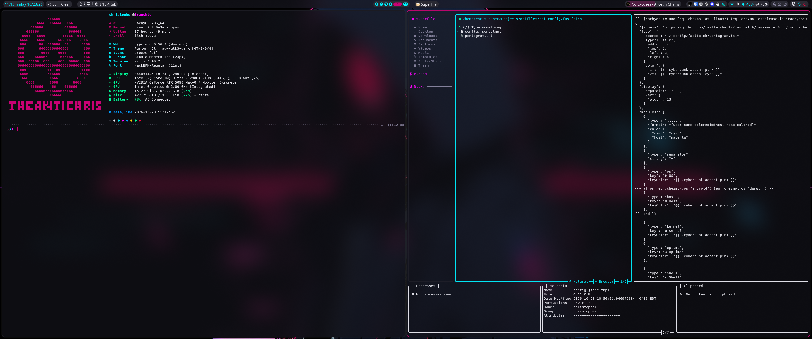
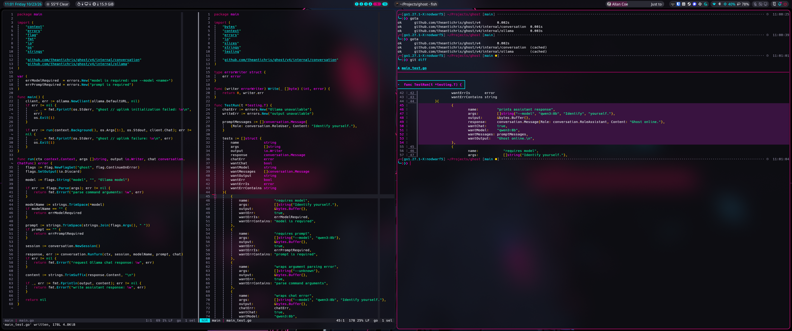
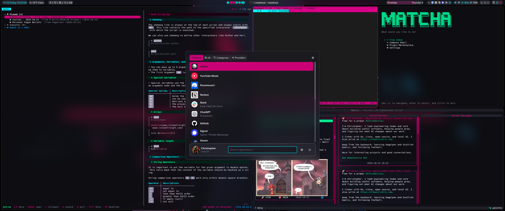

# dotfiles // decker loadout

My Shadowrun inspired, keyboard-driven environment, managed with
[chezmoi](https://www.chezmoi.io). Dark backgrounds, neon accents, and a shared
Cyberpunk palette across the desktop, terminal, editors, and TUIs.



The previous configuration is preserved in
[dotfiles-old](https://github.com/theantichris/dotfiles-old).

## Highlights

- **Hyprland + Noctalia** — a Lua-configured desktop with a launcher, clipboard
  history, notifications, screenshots, and scratchpad terminals.
- **Shared Cyberpunk palette** — one color data file feeds application themes.
- **Fish + Kitty** — a custom prompt, Git shortcuts, and modern CLI tools.
- **Mitos + Helix** — modal editing with language server configuration.
- **Machine-specific templates** — a full CachyOS desktop and a focused Parrot
  CLI setup from the same source tree.

## Screenshots

Mitos editing Go alongside test output and a Git diff rendered by delta.



Noctalia's launcher over the notes, feeds, mail, and Mastodon workspace.



## Platforms

| Target | Scope |
|--------|-------|
| CachyOS | Desktop and CLI configuration, plus package installation hooks |
| Parrot OS (HTB VM) | Selected CLI configuration; keeps the existing MATE session, application defaults, and Git signing |
| Termux (tranch-fold) | Incremental app setup, starting with Git and Helix |

CachyOS is the main desktop. Parrot uses the existing VM toolchain; this repo
does not install its packages. Its exclusions live in
[`.chezmoiignore`](.chezmoiignore).

## Setup

These are personal dotfiles. Review the source before applying, especially Git
identity and signing keys, monitor settings, application paths, and account
configuration.

### Restore my setup

Start with Git, chezmoi, and SSH access to GitHub:

```sh
chezmoi init git@github.com:theantichris/dotfiles.git
chezmoi diff
chezmoi apply
```

On CachyOS, applying runs hooks that install missing packages through `pacman`,
Shelly (`shelly install aur`), Go, and Cargo. The setup expects the CachyOS
desktop tools and Shelly to be available already. Other hooks set Brave as the
default browser, Superfile as the folder opener, add Rust source support, and
rebuild bat's theme cache.

On Parrot, install the CLI tools separately before applying. Templates account
for Debian executable names such as `batcat`, `fdfind`, and `hx`.

### Termux on tranch-fold

With Git, chezmoi, and the SSH signing key available, use the restore commands
above. Applying sets up Git signing, Cyberpunk diffs, and Helix as the Git
editor (`hx`), with syntax grammars, language servers, and formatters.
Supporting tools install through `pkg` and npm.

The `go` and `rust` selections install the Termux toolchains, including Cargo,
Clippy, rustfmt, and Rust source support. They also install `go-global-update`
and `cargo-update` for managing tools installed through Go and Cargo.

The `fish` selection brings over the Cyberpunk prompt, CLI aliases, fuzzy
completion, and Go/Cargo executable paths. It selects Fish for new Termux
sessions; run `exec fish` to switch the current session after applying.
The `update` function upgrades Termux packages and installed Go/Cargo tools.

Enable more apps in [`.chezmoidata/termux.yaml`](.chezmoidata/termux.yaml).
Each app defines its target paths and scripts, with its supporting packages in
[`packages.termux`](.chezmoidata/packages.yaml) under `pkg` and `npm`. Add the app
to `termux.enabled`, review `chezmoi diff`, then apply. `termux.editor` selects
the Git and chezmoi editor; Mitos is the next planned addition.

### Build your own deck

Fork this repository, initialize chezmoi with your fork's URL, and customize the
source before applying. Start with:

- [Git identity and signing](dot_gitconfig.tmpl).
- [Package inventory](.chezmoidata/packages.yaml).
- [Monitor layout](dot_config/hypr/config/monitors.lua) and
  [default desktop apps](dot_config/hypr/config/variables.lua.tmpl).
- [Editor and browser preferences](dot_config/fish/conf.d/environment.fish.tmpl).
- [Noctalia settings](noctalia-settings.toml) and account-specific app configs.

The hostname `tranchion` selects my local Mitos launcher at `~/.local/bin/ms`
and desktop associations. That launcher is installed separately. Other hosts
use Helix, with `hx` selected for Parrot's shell editor.

## Loadout

These are the configured tools. The full installation inventory lives in
[`.chezmoidata/packages.yaml`](.chezmoidata/packages.yaml).

<details open>
<summary><strong>Desktop, shell, and files</strong></summary>

| Tool | Role | Configuration |
|------|------|---------------|
| Hyprland | Window management and keyboard workflow | [`dot_config/hypr`](dot_config/hypr) |
| Noctalia | Desktop shell and Cyberpunk palette | [`noctalia-settings.toml`](noctalia-settings.toml), [`palette`](dot_config/noctalia/palettes/Cyberpunk.json.tmpl) |
| Fish | Shell, prompt, aliases, and updates | [`dot_config/fish`](dot_config/fish) |
| Kitty | Terminal | [`dot_config/kitty`](dot_config/kitty) |
| Superfile | File manager, launched with `spf` | [`dot_config/superfile`](dot_config/superfile) |
| bat / eza | File previews and directory listings | [`bat`](dot_config/bat), [`eza`](dot_config/eza) |
| Fastfetch | System information | [`dot_config/fastfetch`](dot_config/fastfetch) |

Desktop defaults are Kitty, Superfile, Brave Origin, and GNOME Calculator's terminal interface (`gcalccmd`).
Hyprland loads individual Lua modules for bindings, monitors, animations,
window rules, and other settings.

</details>

<details>
<summary><strong>Editing and development</strong></summary>

| Tool | Role | Configuration |
|------|------|---------------|
| Mitos | Main editor on `tranchion` | [`dot_config/mitos`](dot_config/mitos), [`English words`](mitos-dictionary-en_US.txt), [`Gaelic words`](mitos-dictionary-gd_GB.txt) |
| Helix | Editor on other hosts | [`dot_config/helix`](dot_config/helix) |
| Harper | Writing assistance and shared dictionary | [`dot_config/harper-ls`](dot_config/harper-ls), [`dictionary`](harper-dictionary.txt) |
| Git + delta | Version control and themed diffs | [`dot_gitconfig.tmpl`](dot_gitconfig.tmpl), [`dot_gitignore`](dot_gitignore) |
| Codex | Coding agent configuration and theme | [`dot_codex`](dot_codex) |
| Crush | Terminal coding agent configuration | [`dot_config/crush`](dot_config/crush) |

Language server settings live alongside the editor configurations. Packages
include Go, Rust, Bash, Lua, Markdown, TOML, JSON, and YAML tooling.
Mitos checks Markdown against English (`en_US`) and Scottish Gaelic (`gd_GB`).
The GPLv3+ Gaelic Hunspell 3.3 dictionary is downloaded directly from a pinned
[LibreOffice source](https://github.com/LibreOffice/dictionaries/tree/93db4f58c3b2e43003c49d33ce203bdcc8db0b93/gd_GB)
via [chezmoi externals](.chezmoiexternal.toml.tmpl); personal words are managed separately.

</details>

<details>
<summary><strong>Feeds and communication</strong></summary>

| Tool | Role | Configuration |
|------|------|---------------|
| Newsboat | Feed reader | [`dot_config/newsboat`](dot_config/newsboat) |
| Golazo | Football scores | [`dot_config/golazo`](dot_config/golazo) |
| Linecast | Terminal weather | [`dot_config/linecast`](dot_config/linecast) |
| Matcha | Email configuration and Lua plugins | [`dot_config/private_matcha`](dot_config/private_matcha) |
| Mastui | Mastodon profile, keymap, and theme | [`dot_config/mastui`](dot_config/mastui) |

These applications are excluded from the Parrot deployment.

</details>

## Desktop controls

`Super` is the main modifier. The full bindings are in
[`binds.lua`](dot_config/hypr/config/binds.lua).

| Keys | Action |
|------|--------|
| `Super + Return` | Open terminal |
| `Super + Space` | App launcher |
| `Super + E` / `T` / `W` | Open file manager / editor / browser |
| `Super + H/J/K/L` | Focus left / down / up / right |
| `Super + Shift + H/J/K/L` | Move window left / down / up / right |
| `Super + 1–0` | Switch to workspace 1–10 |
| `Super + Shift + 1–0` | Move window to workspace and follow |
| `Super + Q` | Close window |
| `Super + F` | Toggle fullscreen |
| `Super + V` | Clipboard history |
| `Print` / `Super + Print` | Region / fullscreen screenshot |
| Super + grave (backtick) | Toggle dedicated scratchpad terminal |
| `Super + S` / `Super + Shift + S` | Toggle scratchpad / send window to scratchpad |
| `Super + Ctrl + Escape` | Lock screen |
| `Super + Alt + C` | Session menu |
| `Super + /` | Noctalia keybinding cheatsheet plugin |

## Color system

The shared palette lives in
[`.chezmoidata/cyberpunk.yaml`](.chezmoidata/cyberpunk.yaml). Templates read it
through `.cyberpunk` to theme Fish, Git/delta, Kitty, Mitos, Helix, bat,
Superfile, Codex, Mastui, Fastfetch, Newsboat, and Noctalia.

Change shared colors there, then inspect the rendered differences with
`chezmoi diff`. Noctalia's selected custom palette is `Cyberpunk`; Hyprland
loads Noctalia's generated theme at the end of `hyprland.lua`.

## Managing the setup

| Task | Command |
|------|---------|
| Inspect pending changes | `chezmoi diff` |
| Render a managed file | `chezmoi cat ~/.config/kitty/kitty.conf` |
| Open the source directory | `chezmoi cd` |
| Track a file | `chezmoi add <path>` |
| Apply source changes | `chezmoi apply` |
| Pull and apply updates | `chezmoi update` |

**Editing behavior:** [`.chezmoi.toml.tmpl`](.chezmoi.toml.tmpl) enables
`edit.apply`, `git.autoCommit`, and `git.autoPush`. `chezmoi edit` applies edits
on exit, and automatic Git behavior can commit and push source changes. For
manual control, edit files directly in the source checkout and review the diff
before applying. Adjust those options if you prefer a different workflow.

**Live files:** Noctalia's `~/.local/state/noctalia/settings.toml`, Harper's
`~/.config/harper-ls/dictionary.txt`, and Mitos's `en_US.txt` and `gd_GB.txt`
personal dictionaries under `~/.local/state/mitos/dictionaries/` are symlinked
to separate files in this checkout. Editing those source files can affect
running applications immediately.

**Packages:** edit [`.chezmoidata/packages.yaml`](.chezmoidata/packages.yaml).
The CachyOS installation hook runs when its rendered contents change. Fish's
`update` function runs the platform updater, then available Go, Cargo, and
GitHub CLI extension updates.

## License

[MIT](LICENSE) — Copyright (c) 2026 Christopher Lamm.
